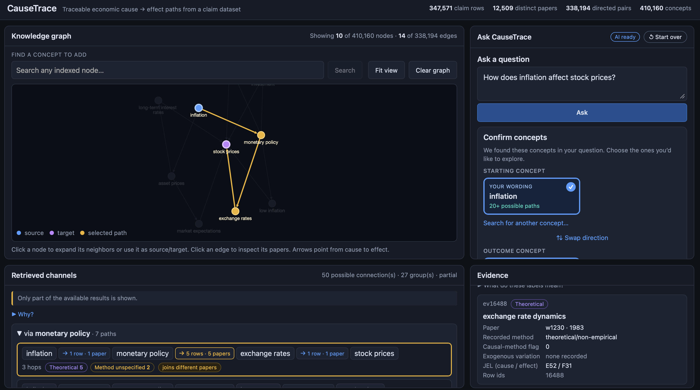
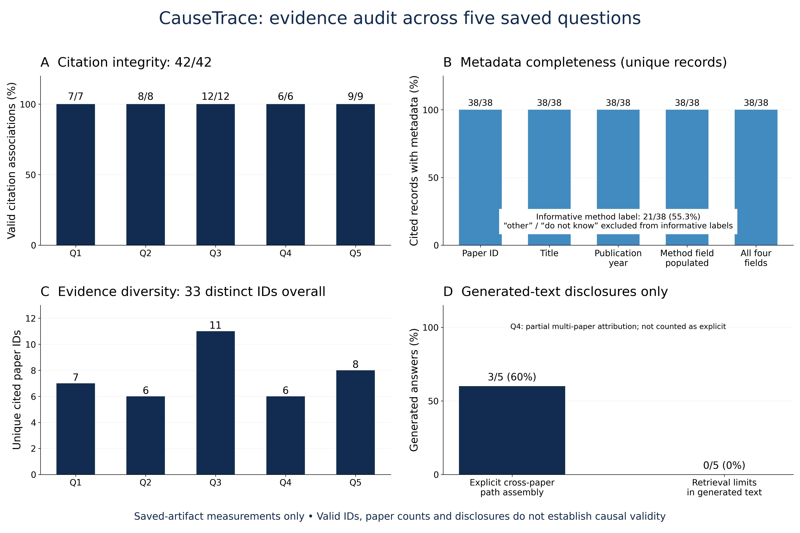

# CauseTrace

**Exploring Economic Causality Through Explainable AI**

CauseTrace is a Causal Graph RAG prototype that helps users explore economic relationships through research-derived knowledge graphs.

Instead of relying solely on AI-generated narratives, users can inspect candidate economic pathways and the academic evidence behind individual connections.

## Demo: How Does Inflation Affect Stock Prices?

**1. Ask**
*"How does inflation affect stock prices?"*

**2. Explore**
CauseTrace retrieves research-linked economic pathways. Example (an illustrative candidate pathway, not a validated causal chain):

`Inflation → Monetary Policy → Exchange Rates → Stock Prices`

**3. Inspect Evidence**
Click a graph connection to view the research records behind it: paper references, publication years and available research-method metadata.

**4. Explain**
A local LLM generates an evidence-linked explanation using retrieved records and checked citation IDs.

> Retrieved paths represent candidate research connections, not independently validated causal relationships.



*The highlighted pathway is a candidate retrieved from research-derived claims. The Evidence panel shows the research record behind the selected connection.*

## How It Works

`Question → Concept Confirmation → Graph Retrieval → Evidence Inspection → AI Explanation`

- **React + Cytoscape.js**: interactive graph interface
- **FastAPI + NetworkX**: graph search and evidence retrieval
- **BGE-M3 + FAISS**: semantic concept matching
- **Qwen3:4b + Ollama**: local question parsing and explanation

## XAI Evaluation

| Metric | Result |
|---|---|
| Citation Integrity | 42/42 (100%) |
| Core Metadata Completeness | 38/38 (100%) |
| Informative Method Labels | 21/38 (55.3%) |
| Explicit Cross-paper Disclosure | 3/5 (60%) |

Citation validation confirms record association, not semantic accuracy or causal validity. The evaluation covers five economic questions.



## Quick Start

> **Not distributed with this repository:** the research dataset and the FAISS index. You generate the three runtime files yourself from the original research data. A fresh clone will not run until you have done so.

```bash
python3 -m venv .venv && .venv/bin/python -m pip install -r requirements.txt   # Python 3.9
(cd frontend && npm install)
ollama pull qwen3:4b                      # Ollama must be running
# generate the runtime files from the original data (see below): data/macro_claims.parquet,
#   indexes/kg_nodes.json, indexes/kg_bge_m3.faiss (~1.7 GB in total)
./run_causetrace.sh start                 # then open http://127.0.0.1:5173
```

To generate the files, obtain the original data from the [authors' repository](https://github.com/prashgarg/CausalClaimsInEconomics) and run [`notebooks/build_index.ipynb`](notebooks/build_index.ipynb), which filters the macroeconomic claims and embeds every concept with BGE-M3. Embedding takes a long time on a laptop. Prerequisites, troubleshooting and reproducibility notes: [Technical Guide](docs/TECHNICAL_GUIDE.md).

## Research Attribution & License

Built using research-derived claims from Garg & Fetzer, *Causal Claims in Economics* ([arXiv:2501.06873](https://arxiv.org/abs/2501.06873); [original data and code](https://github.com/prashgarg/CausalClaimsInEconomics)).

The original data and code are **not redistributed here**: the original repository publishes no license, so redistribution permission is unresolved.

The [MIT License](LICENSE) applies only to original CauseTrace code; third-party materials keep their own terms. Details: [Technical Guide](docs/TECHNICAL_GUIDE.md#license).
