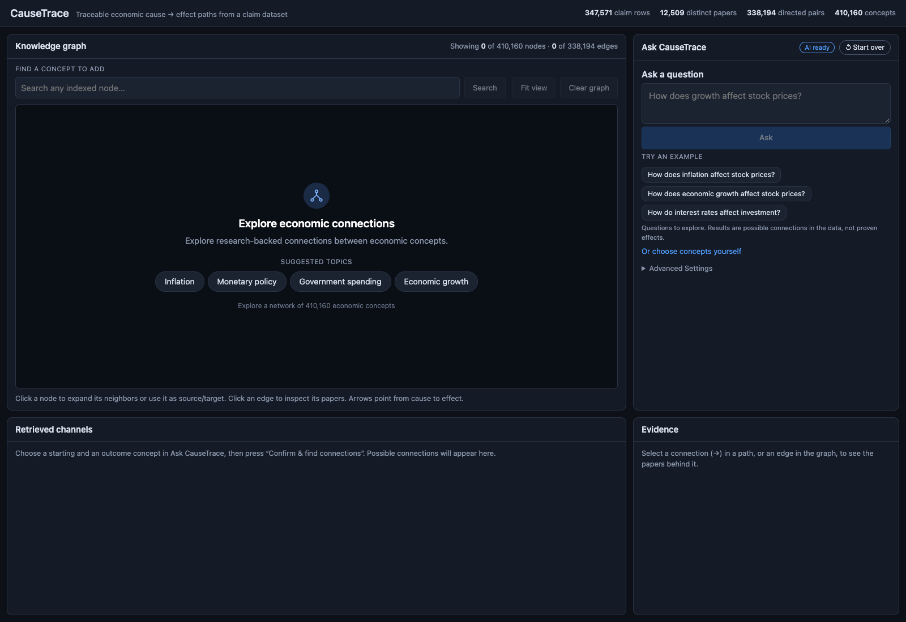

# CauseTrace — Technical Guide

> Detailed documentation. For a short overview, see the [README](../README.md).

**A local, inspectable question-answering tool for economic cause → effect claims.**
Ask a question, confirm the concepts it refers to, retrieve bounded directed paths through a knowledge graph of claims, read the research records behind every connection, and optionally get a short AI explanation that is written *only* from those retrieved records.

CauseTrace is an Explainable-AI (XAI) project. It explains **which records and graph paths an answer is based on**. It does not expose a language model's internal reasoning, and it does not decide whether an economic relationship is true.



> **Status:** research prototype. The research dataset and search indexes are **not** included in this repository (see [Required external data and models](#required-external-data-and-models) and [Original research data attribution](#original-research-data-attribution)).

---

## What CauseTrace does

1. **Ask** a question in plain language, for example *"How does inflation affect stock prices?"*.
2. A local language model (Qwen3 4B through Ollama) proposes the **cause** and **effect** concepts. They are only proposals.
3. **Confirm concepts.** Each concept is matched to a node in the graph by exact name and by semantic similarity (BGE-M3). You choose between your wording and, when one exists, a single suggested alternative (for example the plural *stock prices* for *stock price*). Nothing is searched until you confirm, and your concept is never replaced automatically.
4. **Retrieve.** CauseTrace searches for directed paths with strict limits on path length, number of results and time. Results are shown in **Retrieved Channels**, grouped by their first intermediate concept, and the selected path is highlighted in the **Knowledge Graph**.
5. **Explore the evidence.** Clicking a connection opens the original claim records in **Evidence**: paper ID, year, recorded method, evidence class, exogenous-variation text and JEL codes.
6. **Explain with AI (optional).** The model summarises a bounded sample of the retrieved records. Every cited evidence ID is checked mechanically against the records that were actually supplied.

### Design principles

- **Candidate paths, not causal chains.** A path joins separate claim records, often from different papers. It is labelled as a *possible connection*; compatibility across papers, conditions, signs and magnitudes are not assessed.
- **Retrieval relevance is not evidence quality.** Cosine similarity, path length, edge counts and paper counts are never presented as causal confidence.
- **Honest limits.** When a search stops at a limit, the result says so. "No path found within these limits" never means "no relationship exists".
- **Provenance first.** Counts are kept in separate units: claim rows, distinct papers, directed concept pairs and concepts. Identical displayed records are merged, but their original row IDs are kept.
- **Local only.** No cloud API, no paid service. The backend, the frontend and the models all run on your machine and bind to `127.0.0.1`.

---

## System architecture

```
Browser (React 19 + Vite + Cytoscape.js)          127.0.0.1:5173
        │  HTTP / JSON
FastAPI backend (single worker)                   127.0.0.1:8000
   ├─ claims table (parquet)    → evidence lookup; every supporting row is kept
   ├─ NetworkX DiGraph          → bounded, shortest-first directed path search
   ├─ FAISS IndexFlatIP + BGE-M3 (CPU) → semantic concept matching
   └─ Ollama client (qwen3:4b)  → question parsing and explanation   127.0.0.1:11434
```

| Component | Location |
|---|---|
| API and endpoints | [`api.py`](../api.py) |
| Data loading and start-up validation | [`causetrace/resources.py`](../causetrace/resources.py) |
| CPU query encoder (BGE-M3) | [`causetrace/encoder.py`](../causetrace/encoder.py) |
| Graph and pair → claim-row index | [`causetrace/graph.py`](../causetrace/graph.py) |
| Bounded path search | [`causetrace/paths.py`](../causetrace/paths.py) |
| Evidence records and evidence classes | [`causetrace/evidence.py`](../causetrace/evidence.py) |
| Thin-concept hints and related-concept suggestions | [`causetrace/suggest.py`](../causetrace/suggest.py) |
| Ollama client | [`causetrace/llm.py`](../causetrace/llm.py) |
| Evidence pack, prompts, citation checks | [`causetrace/explain.py`](../causetrace/explain.py) |
| Question-set runner / index spot-check tools | [`causetrace/evaluate.py`](../causetrace/evaluate.py), [`causetrace/verify_stage1.py`](../causetrace/verify_stage1.py) |
| Frontend | [`frontend/`](../frontend/) |
| Unit tests | [`tests/`](../tests/) |
| Index build recipe | [`notebooks/build_index.ipynb`](../notebooks/build_index.ipynb) |
| Evaluation summaries | [`evaluation/`](../evaluation/) |

### Bounds that keep retrieval and explanation inspectable

| Stage | Bound |
|---|---|
| Concept search | `top_k` ≤ 50; query ≤ 500 characters and ≤ 64 tokens (truncation is reported) |
| Path search | max path length 1–4 connections (default 3), max results 20 / 50 / 100 / 200 (default 50), time limit 2 / 5 / 10 / 20 s (default 5). Shortest first, simple paths only. Hitting a limit sets `truncated` and says why |
| Neighbourhood expansion | ≤ 100 edges per request; the graph view never draws more than 400 nodes |
| Evidence sent to the language model | ≤ 6 paths, ≤ 4 records per edge, ≤ 9,000 characters; the response states how much was sent versus available |

### Safeguards around the language model

- Record text (titles, fields) is passed as JSON string values and labelled as untrusted data; the question is delimited as data. This reduces, but cannot guarantee against, prompt injection.
- Model output is constrained to a JSON schema. Each claim must name one edge and cite evidence IDs.
- The server **re-runs retrieval itself** for `/explain`; the model never sees client-supplied evidence.
- Every cited ID must exist in the supplied records **and** belong to the edge the claim names. Invented IDs are removed and reported; IDs from another edge are rejected.
- Limitations shown with an explanation are computed from what was sent (subset size, evidence-class counts, paths that join different papers), not written by the model.
- A simple word list flags causal wording ("affects", "influences", …), because the dataset records that a link was *claimed*, not an established effect. It is a heuristic and misses paraphrases.

What the citation check does **not** do: verify that a sentence is a faithful reading of its record, or that the original paper supports it.

### Evidence classes

Descriptive labels derived from dataset fields. They say nothing about validity.

| Class | Rule |
|---|---|
| `causal_method_tagged` | `is_method_causal_inference = 1` |
| `theoretical` | recorded method is `theoretical/non-empirical` |
| `unspecified_method` | method is `other`, `do not know` or missing |
| `other_method_not_causal_tagged` | any other recorded method without the causal flag |

---

## Required external data and models

CauseTrace needs three things that are **not in this repository**.

### 1. Runtime data (from the original research dataset)

| File | What | Development build |
|---|---|---|
| `data/macro_claims.parquet` | claim records (required columns `paper_id`, `cause`, `effect`; also uses `title`, `year`, `edge_overlap`, `sources_of_exogenous_variation`, `jel_cause`, `jel_effect`, `is_method_causal_inference`, `causal_inference_method`) | 14 MB, 347,571 rows, 12,509 distinct papers |
| `indexes/kg_nodes.json` | concept names in exact FAISS-ID order | 19 MB, 410,160 concepts |
| `indexes/kg_bge_m3.faiss` | `IndexFlatIP`, L2-normalised BGE-M3 vectors, 1024 dimensions | 1.56 GiB (1.68 GB) |

How to obtain them: get the original data release (see [attribution](#original-research-data-attribution)), then run [`notebooks/build_index.ipynb`](../notebooks/build_index.ipynb) from the repository root. It reads the aggregated graph shards, keeps macroeconomic claims, lower-cases and strips `cause`/`effect`, builds the directed graph, embeds every concept with BGE-M3 and writes the three files above. Embedding all concepts takes a long time on a laptop. The notebook needs a few packages that `requirements.txt` does not pin: `jupyterlab` (or another notebook runner), `tqdm` and the `ollama` Python client (imported in its first cell); install them with `pip install jupyterlab tqdm ollama`. It sorts the node names and indexes them in that order, and it does not pin the embedding device (the runtime queries are encoded on the CPU; see below). Do not rename, reorder or partially regenerate the node list or the index: `kg_nodes.json[i]` must be the text of vector `i`. At start-up the backend verifies that the node list equals the set of normalised labels in the claims table, that the counts match, and that a sample of stored vectors has unit length (a sample, not every vector).

See also [`data/README.md`](../data/README.md) and [`indexes/README.md`](../indexes/README.md).

### 2. Embedding model

[`BAAI/bge-m3`](https://huggingface.co/BAAI/bge-m3), downloaded automatically from Hugging Face on first use (about 4 GB in the local cache on the development machine). Check the model card for its licence.

**CPU encoding workaround.** On the development machine (Apple Silicon), BGE-M3 on the MPS backend produced query vectors that differed between single and batched inputs. For the nodes tested, CPU single-input and batch embeddings matched the stored vectors (cosine 1.0). All query encoding therefore runs on the CPU:

```python
BGEM3FlagModel("BAAI/bge-m3", use_fp16=False, devices=["cpu"])
model.encode_single_device([text], device="cpu", max_length=64,
                           return_dense=True, return_sparse=False, return_colbert_vecs=False)
# then: float32, L2-normalise, search the unchanged FAISS index
```

Queries are stripped and lower-cased like the node labels before encoding. The model loads lazily on the first search. `python -m causetrace.verify_stage1` re-checks that random nodes retrieve themselves at rank 1 (25 of 25 did in the development build). That is a sample, not a proof for all vectors.

### 3. Language model

[Ollama](https://ollama.com) with `qwen3:4b` (about 2.5 GB). Check the model card for its licence. CauseTrace works without it for manual concept search, path retrieval and evidence inspection; only question parsing and explanations need it.

---

## Run it locally

Tested on a MacBook Air (Apple M5, 16 GB) with Python 3.9.6, Node.js 24 and Ollama 0.40.5. Other platforms are untested.

```bash
# 1. Python environment (versions are pinned for the tested setup)
python3 -m venv .venv
.venv/bin/python -m pip install -r requirements.txt

# 2. Frontend dependencies
(cd frontend && npm install)

# 3. Language model
ollama pull qwen3:4b          # the Ollama app / `ollama serve` must be running

# 4. Data: place data/macro_claims.parquet and indexes/* (see above)

# 5. Start backend (:8000) and frontend (:5173)
./run_causetrace.sh start
./run_causetrace.sh status
./run_causetrace.sh stop
```

Open <http://127.0.0.1:5173> (API documentation at <http://127.0.0.1:8000/docs>). Logs are written to `.run/`. Loading the data and building the graph takes a short while; the first search additionally loads BGE-M3.

Manual alternative, in two terminals:

```bash
.venv/bin/python -m uvicorn api:app --host 127.0.0.1 --port 8000     # one worker only; no --reload
cd frontend && npm run dev -- --host 127.0.0.1 --port 5173
```

Use a single worker: each process would load its own copy of the index and the embedding model. If you also use the notebook, shut its kernel down first for the same reason.

After the first download BGE-M3 is read from the local cache. The code does not force offline mode, so if you demonstrate without internet, test it once beforehand (`HF_HUB_OFFLINE=1` is the usual switch; this has not been verified here).

### Configuration

| Variable | Default | Purpose |
|---|---|---|
| `CAUSETRACE_OLLAMA_URL` | `http://127.0.0.1:11434` | Ollama server |
| `CAUSETRACE_OLLAMA_MODEL` | `qwen3:4b` | model used for parsing and explanation |
| `VITE_API_URL` (frontend) | `http://127.0.0.1:8000` | backend address |

CORS allows only `localhost` / `127.0.0.1` on ports 5173 and 4173.

### API

`GET /health` · `GET /nodes/search` · `GET /nodes/lookup` · `GET /graph/overview` · `GET /graph/neighborhood` · `GET /edges/evidence` · `POST /paths` · `POST /paths/suggest` · `GET /llm/status` · `POST /ask/parse` · `POST /explain`. Interactive documentation is served at `/docs`.

If Ollama is unreachable or the model is missing, `/llm/status` says so, `/ask/parse` and `/explain` return HTTP 503 with the reason, and the interface disables the question box and the explanation button while manual search, path retrieval and evidence inspection keep working.

### Tests

```bash
PYTHONDONTWRITEBYTECODE=1 .venv/bin/python -m unittest discover -s tests -t . -v
```

53 unit tests. They use a small synthetic claims table and a scripted stand-in for the language model, so they need neither the data, the indexes nor any model. They cover path direction, evidence-to-edge mapping, duplicate rows versus distinct paper counts, search and path bounds, missing results, suggestion rules, evidence-pack limits and disclosure, citation validation, and Ollama-unavailable behaviour. There are no automated frontend tests.

---

## Key XAI evaluation results

Five hand-picked questions, one generation per condition, comparing a **no-retrieval Qwen3:4b baseline** with **CauseTrace** (same model, temperature 0, context 8,192). Details, definitions and per-case tables are in [`evaluation/`](../evaluation/).

| # | Question concepts |
|---|---|
| Q1 | inflation → stock prices |
| Q2 | economic growth → stock prices |
| Q3 | interest rates → investment |
| Q4 | government spending → economic growth |
| Q5 | monetary policy shocks → exchange rates |

**Citation integrity (CauseTrace).** 42 of 42 structured citation entries belonged to the edge the claim named, and every one resolved to a saved record. The baseline, which retrieves nothing, made no structured citations (not applicable, not 0% or 100%).

**Inspectability capabilities** (deterministic audit of saved artifacts; scale 0 = capability absent, 2 = present and verified; n = 5 cases each):

| System | Citation traceability | Evidence accessibility | Evidence transparency | Retrieval transparency |
|---|---|---|---|---|
| Baseline | 0 | 0 | 0 | 0 |
| CauseTrace | 2 | not assessed | 2 | 2 |

A baseline 0 means the tested workflow offers no way to trace a claim to a record; it does **not** mean its answers are wrong. CauseTrace's *evidence accessibility* is "not assessed" because no saved browser interaction exists for the five cases.

**What the 38 cited records look like** (audit of CauseTrace's saved evidence):

- 38 distinct cited records from 33 distinct paper IDs.
- All four checked metadata fields (paper ID, title, year, method) were populated for 38 of 38 records.
- Only **21 of 38 (55.3%)** carried an *informative* method label; the other 17 were the placeholders `other` or `do not know`.
- Generated answers stated explicitly that paths combine different papers in **3 of 5** cases, and stated the retrieval limits in **0 of 5** (the system itself saved the limits for 5 of 5).
- 4 of 5 searches stopped at the 50-path cap, so the retrieved path lists were incomplete.

**Not established by this evaluation.** Valid citation IDs are not semantic faithfulness; no human answer-quality scores or causal-validity verdicts have been entered (the review template in `evaluation/comparison_scores.csv` is blank). The comparison also differs in prompt, output format and token limit between the two conditions, so it cannot isolate the effect of retrieval. In an earlier run the baseline reached the 900-token cap in 5 of 5 cases; the capability audit used a second baseline run with a concise prompt and 2,048 tokens, which completed normally.

---

## Limitations

- **Candidate paths are not validated causal chains.** They join separate claim records. Sign, magnitude, conditions, identification and cross-paper compatibility are not in the data and are not assessed. Dataset method flags are metadata, not proof of validity.
- **Explanation text is model-written.** Its citations are mechanically checked; its wording and its fit to the records are not, beyond a causal-word heuristic. A 4B local model can mis-parse questions or ignore prompt rules, so concept mappings are always shown for you to check. Explanations took roughly 14–21 seconds per question on the development laptop.
- **Concepts are free-text strings.** Near-duplicates ("stock price" / "stock prices") are separate nodes and evidence is often concentrated in one of them. Paths do not bridge them and nodes are never merged. A card's "possible paths" hint is a quick check (up to 3 connections), not a measure of evidence strength.
- **Bounded search.** Only a bounded part of the graph is drawn and searched; longer paths are more likely to join unrelated findings.
- **Evaluation scope.** Five selected questions; see above.
- **Platform.** Tested on one machine and in Chrome only.
- **Original papers were not reviewed.** Nothing here has been checked against the full texts.

---

## Original research data attribution

CauseTrace is an independent project built on top of the data release that accompanies the paper:

> Garg, Prashant, and Thiemo Fetzer. **"Causal Claims in Economics."** arXiv:2501.06873 (v1: 12 January 2025; v2: revised 24 February 2026). <https://arxiv.org/abs/2501.06873>
> Data, code and prompts: <https://github.com/prashgarg/CausalClaimsInEconomics>

```bibtex
@misc{garg_fetzer_causal_claims_economics,
  title         = {Causal Claims in Economics},
  author        = {Garg, Prashant and Fetzer, Thiemo},
  year          = {2025},
  eprint        = {2501.06873},
  archivePrefix = {arXiv},
  url           = {https://arxiv.org/abs/2501.06873},
  note          = {Version 2, revised 24 February 2026}
}
```

The claims table, the graph and the embeddings that CauseTrace uses are derived from that release. Please cite the paper if you use CauseTrace's outputs.

**Licensing status of the original material (checked 18 October 2026):**

- The data/code repository above shows **no license file**, and GitHub's license API reports none. Without a license, no right to redistribute its data or code can be assumed. **Nothing from it is redistributed here**: no data, no derived tables or indexes, no paper PDF, no slides, no reproduction scripts.
- The paper on arXiv displays a Creative Commons Attribution 4.0 license link. That license applies to the paper text, not to the code and data release.
- CauseTrace is not affiliated with or endorsed by the original authors. If you want to build the runtime files, obtain the data yourself from the original repository and follow whatever terms its authors set; if in doubt, ask them.

Models and libraries keep their own licenses: BAAI/bge-m3 (Hugging Face), Qwen3 (via Ollama), FAISS, NetworkX, FastAPI, React, Vite and Cytoscape.js.

## Repository layout

```
.
├── api.py                       FastAPI application
├── causetrace/                  backend package (loading, graph, paths, evidence, LLM, explanation)
├── frontend/                    React + Vite interface
├── tests/                       53 unit tests (no data or models required)
├── notebooks/build_index.ipynb  recipe for the runtime data and indexes (outputs cleared)
├── evaluation/                  published evaluation summaries and figures
├── docs/                        screenshot and historical development checklist
├── data/   indexes/             empty; see their READMEs
├── requirements.txt             pinned Python dependencies
└── run_causetrace.sh            start / stop / status helper
```

## License

The [MIT License](../LICENSE) applies **only to the original CauseTrace source code** in this repository: the backend (`api.py`, `causetrace/`), the frontend source (`frontend/src` and its configuration), the tests, `run_causetrace.sh`, and the code cells of `notebooks/build_index.ipynb`.

It does **not** apply to, and grants no rights in:

- the research data, derived tables or search indexes (not included; see above);
- the original paper, its PDF, slides, reproduction scripts or prompts (not included);
- pretrained models (BGE-M3, Qwen3), which are downloaded separately under their own licenses;
- third-party libraries, which are installed from `requirements.txt` and `frontend/package.json` under their own licenses.

The documentation and the evaluation summaries are provided for reference and are not covered by the MIT License unless a file says otherwise.
